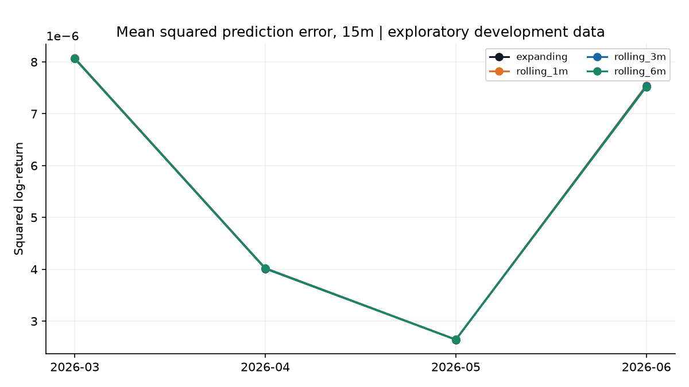
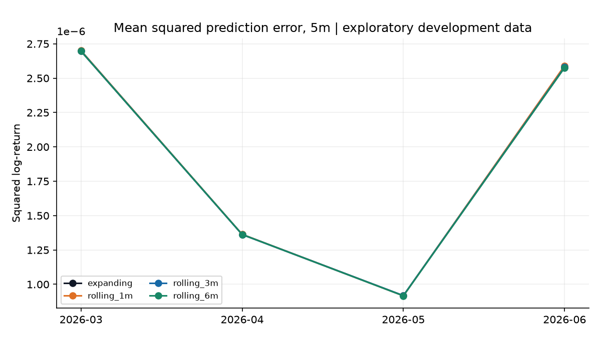
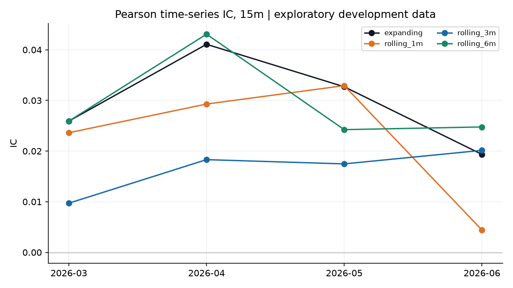
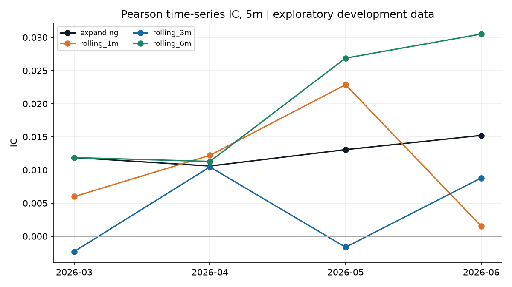
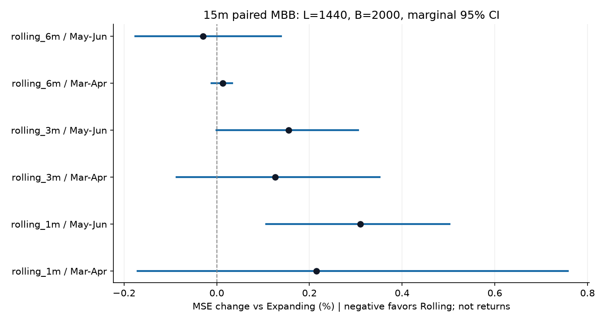
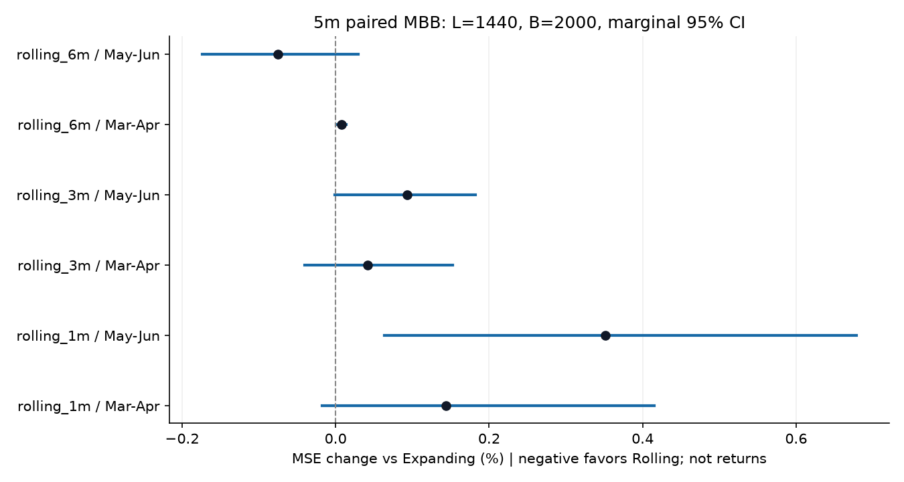
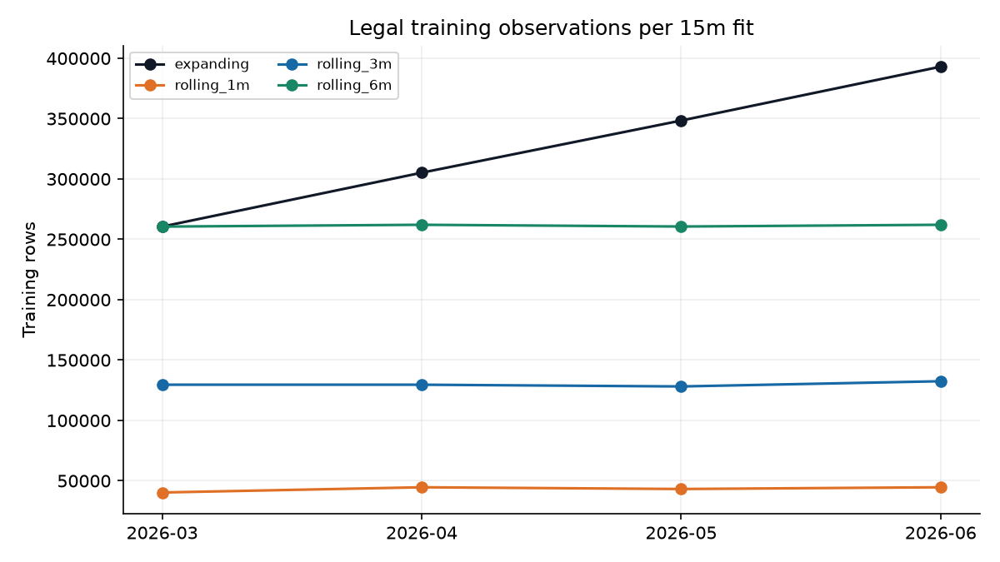

# Phase 2D-A：固定窗口与扩张窗口的探索性预测实验

核查日期：2026-11-03（Asia/Shanghai）。**没有发现 Rolling 优于 Expanding 的稳健平方误差证据。主 15m/3M Validation 对照 MSE 反而高 0.125869%，95% MBB 相对差区间为 [−0.086806%, +0.351043%]，HAC p=0.272831、Holm6 p=1。**这既不证明严格等效，也不证明市场没有概念漂移。

本研究重复使用 Phase 2B/2C 已见的四个月。协议在本轮开发前冻结，但结果仍是探索性开发证据，**不是新的确认性 OOS 证据**；May/June 从未重新命名为独立测试集。无需显著性即可验收工程，全部负结果保留。

## 冻结协议与完整设置

- 协议提交：`84140cec007a3131872eaeb4dbb764a0639da255`，先于算法实现。
- 实现提交：`5acaeb0b74e6a2c528e97ad1f53527c4eb4189a5`；正式与复跑均 `git_dirty=false`。
- 协议 SHA-256：`263368b6153750ba314dcd024878c61214141976b056d30871a6d384ccba7617`；配置 SHA-256：`9f3f75dd21b6bef5e41a309a7cdb73efc5ae908bc33b1d57d4e654d4d882acf4`。
- 正式 run：`20261103T030302685501Z-d124511e`；唯一同配置复跑：`20261103T030457400531Z-daa632f2`。
- 仅用既有 Binance Spot BTCUSDT 1m、2025-09 至 2026-06 的 436,320 根真实 bar。14 个原有因果特征，1 秒可用延迟，15m 主标签、5m 辅标签。
- StandardScaler 仅拟合本窗口合法训练行；Ridge alpha=1、solver=svd、seed42，三个数值线程池实际均为 1。无新依赖或全局环境变更。
- 四种 Ridge × 四个月 × 两个 horizon = **32 次正式 Ridge fit**；另有16次 expanding Zero/Mean参考拟合。复跑32次单独计数，不是候选搜索。

完整冻结约定见 [分析计划](phase2d-a-analysis-plan.md)、[计划清单](phase2d-a-plan-manifest.json) 和 [配置副本](phase2d-a-evidence/resolved-config.json)。

## 四种训练程序与时间边界

Expanding 从2025-09-01起积累；Rolling 1M/3M/6M 分别从 `fit_time - 1/3/6 calendar months` 开始。fit_time 固定为预测月初UTC00:00:00，窗口按 **decision_time** 归属，不能用bar_open_time或文件月份替代。

|预测月|1M起点|3M起点|6M起点|排他训练上限|
|---|---|---|---|---|
|2026-03|2026-02-01|2025-12-01|2025-09-01|2026-03-01|
|2026-04|2026-03-01|2026-01-01|2025-10-01|2026-04-01|
|2026-05|2026-04-01|2026-02-01|2025-11-01|2026-05-01|
|2026-06|2026-05-01|2026-03-01|2025-12-01|2026-06-01|

候选满足 start ≤ decision_time < fit_time，随后要求特征和标签已可用、特征与标签有效、目标不越界、不重叠、连续性合法。Rolling始终是原Expanding合法训练索引子集，原始排序保留。因果特征使用全部已观察历史计算，不在rolling起点凭空重置warm-up。例如Jan31最后一分钟bar的decision_time在Feb1，因此能属于February训练窗口；Feb末最后一分钟bar不能进入March月初拟合。

所有模型共用完整相同的评估键、标签与时点。评估标签必须在下一月初成熟；June不读取July补齐标签。预测2,107,680行对应 **351,280个配对horizon观测**，不是这么多个独立样本。

## 实际样本数与排除审计

| month | horizon_minutes | expanding | rolling_1m | rolling_3m | rolling_6m |
| --- | --- | --- | --- | --- | --- |
| 2026-03 | 5 | 260574 | 40315 | 129595 | 260574 |
| 2026-03 | 15 | 260564 | 40305 | 129585 | 260564 |
| 2026-04 | 5 | 305214 | 44635 | 129595 | 262075 |
| 2026-04 | 15 | 305204 | 44625 | 129585 | 262065 |
| 2026-05 | 5 | 348414 | 43195 | 128155 | 260635 |
| 2026-05 | 15 | 348404 | 43185 | 128145 | 260625 |
| 2026-06 | 5 | 393054 | 44635 | 132475 | 262075 |
| 2026-06 | 15 | 393044 | 44625 | 132465 | 262065 |

每月评估数15m/5m分别为March44,625/44,635、April43,185/43,195、May44,625/44,635、June43,185/43,195。初始60行特征warm-up无效；没有额外缺口或无效值。每个训练窗口排除h个未成熟标签（h=15或5），各原因计数可能重叠，不能直接相加。独立自然月算术与全部32个audit的候选/排除/有效数一致。

初始Expanding/March6M的候选数比完整日历分钟数少1：缺少开发起点前的Aug31末bar；再排除60 warm-up和h个未成熟标签。其他rolling包含合法的前月最后bar，实际训练数为窗口日历分钟数减h。完整计数、索引hash、成熟时间极值见 [window-audit.json](phase2d-a-evidence/window-audit.json)。

## 全部月度指标

MSE为平方对数收益单位，MAE为对数收益单位。`mse_improvement_percent_expanding` = 100×(Expanding MSE−模型MSE)/Expanding MSE，**正为改善、负为退化，不是收益率**。这里IC为月内时间序列Pearson相关。Zero/Mean及Spearman、偏差、尺度、校准全部列在 [metrics.csv](phase2d-a-evidence/metrics.csv)，没有删掉不利月份。

| month | horizon_minutes | model | mse | mae | pearson_ic | mse_improvement_percent_expanding | mse_improvement_percent_zero |
| --- | --- | --- | --- | --- | --- | --- | --- |
| 2026-03 | 15 | expanding | 8.06137414e-06 | 0.00191357683 | 0.0259217608 | -0 | 0.0548155094 |
| 2026-03 | 15 | rolling_1m | 8.07623989e-06 | 0.00191045271 | 0.0236268122 | -0.184407229 | -0.129490636 |
| 2026-03 | 15 | rolling_3m | 8.06911179e-06 | 0.00191396037 | 0.00971187087 | -0.0959843412 | -0.0411162175 |
| 2026-03 | 15 | rolling_6m | 8.06137414e-06 | 0.00191357683 | 0.0259217608 | -0 | 0.0548155094 |
| 2026-04 | 15 | expanding | 4.01312481e-06 | 0.00136600497 | 0.0410830966 | -0 | 0.0625970654 |
| 2026-04 | 15 | rolling_1m | 4.02431668e-06 | 0.00136889262 | 0.0292850353 | -0.27888164 | -0.216110003 |
| 2026-04 | 15 | rolling_3m | 4.02066558e-06 | 0.00136654781 | 0.0183091411 | -0.187902715 | -0.125188028 |
| 2026-04 | 15 | rolling_6m | 4.01469338e-06 | 0.0013667203 | 0.0430840268 | -0.0390859719 | 0.0235355602 |
| 2026-05 | 15 | expanding | 2.6424867e-06 | 0.00110558161 | 0.0326992332 | -0 | 0.0835913253 |
| 2026-05 | 15 | rolling_1m | 2.6450261e-06 | 0.00110640938 | 0.0329222665 | -0.0960987735 | -0.012427118 |
| 2026-05 | 15 | rolling_3m | 2.64574572e-06 | 0.00110552568 | 0.0174708992 | -0.123331212 | -0.0396367929 |
| 2026-05 | 15 | rolling_6m | 2.64345718e-06 | 0.00110537272 | 0.0242345337 | -0.0367260179 | 0.0468960071 |
| 2026-06 | 15 | expanding | 7.523331e-06 | 0.00183780434 | 0.0193537273 | -0 | 0.0185261092 |
| 2026-06 | 15 | rolling_1m | 7.55246554e-06 | 0.00183987331 | 0.00442185108 | -0.387255798 | -0.368657945 |
| 2026-06 | 15 | rolling_3m | 7.53584771e-06 | 0.00183926931 | 0.0201405906 | -0.166371842 | -0.14781491 |
| 2026-06 | 15 | rolling_6m | 7.51931447e-06 | 0.00183760344 | 0.0247641754 | 0.0533876708 | 0.0719038894 |
| 2026-03 | 5 | expanding | 2.69663367e-06 | 0.00108900198 | 0.0118724371 | -0 | -0.0128898421 |
| 2026-03 | 5 | rolling_1m | 2.70125469e-06 | 0.00108897727 | 0.00598229197 | -0.171362774 | -0.184274705 |
| 2026-03 | 5 | rolling_3m | 2.69834247e-06 | 0.0010891565 | -0.00229626912 | -0.0633679802 | -0.0762659903 |
| 2026-03 | 5 | rolling_6m | 2.69663367e-06 | 0.00108900198 | 0.0118724371 | -0 | -0.0128898421 |
| 2026-04 | 5 | expanding | 1.36242e-06 | 0.000781769976 | 0.0105950906 | -0 | -0.0530702108 |
| 2026-04 | 5 | rolling_1m | 1.36362021e-06 | 0.000781847034 | 0.0122082551 | -0.0880943383 | -0.141211301 |
| 2026-04 | 5 | rolling_3m | 1.36237886e-06 | 0.000781321444 | 0.0104601134 | 0.0030196343 | -0.0500489739 |
| 2026-04 | 5 | rolling_6m | 1.36273092e-06 | 0.000781892482 | 0.0112878181 | -0.0228213506 | -0.0759036727 |
| 2026-05 | 5 | expanding | 9.17094699e-07 | 0.00064116853 | 0.013068516 | -0 | -0.0217540734 |
| 2026-05 | 5 | rolling_1m | 9.16778838e-07 | 0.000640762808 | 0.0228589052 | 0.0344413946 | 0.0126948136 |
| 2026-05 | 5 | rolling_3m | 9.17843207e-07 | 0.000640854696 | -0.00165100991 | -0.0816173101 | -0.103389139 |
| 2026-05 | 5 | rolling_6m | 9.16264246e-07 | 0.000640486798 | 0.0268763139 | 0.0905525013 | 0.0688181267 |
| 2026-06 | 5 | expanding | 2.57802542e-06 | 0.00105887069 | 0.0152126836 | -0 | 0.00957253922 |
| 2026-06 | 5 | rolling_1m | 2.59074348e-06 | 0.00106065254 | 0.00152882436 | -0.493325987 | -0.483706224 |
| 2026-06 | 5 | rolling_3m | 2.58053184e-06 | 0.00105903288 | 0.00879923318 | -0.0972228333 | -0.0876409874 |
| 2026-06 | 5 | rolling_6m | 2.5762351e-06 | 0.0010581347 | 0.0305067005 | 0.0694452618 | 0.0790111533 |

1M与3M在15m四个月全部更差；6M在March精确相同、April/May更差、June改善0.053388%。5m的3M只在April微弱改善0.003020%，其余更差；6M在May/June有小幅改善，但角色区间跨0。不能根据5m或单月改写15m主结论。

## 预测尺度与校准

| month | horizon_minutes | model | spearman_correlation | prediction_bias | prediction_std | target_std | std_ratio | diagnostic_slope |
| --- | --- | --- | --- | --- | --- | --- | --- | --- |
| 2026-03 | 15 | expanding | 0.0392267456 | -2.79628762e-05 | 8.97594016e-05 | 0.00284002665 | 0.0316051265 | 0.820175828 |
| 2026-03 | 15 | rolling_1m | 0.0557499973 | -8.17359055e-05 | 0.000158261523 | 0.00284002665 | 0.0557253654 | 0.423986671 |
| 2026-03 | 15 | rolling_3m | 0.0366491951 | -4.31645967e-05 | 7.51004818e-05 | 0.00284002665 | 0.0264435835 | 0.367267579 |
| 2026-03 | 15 | rolling_6m | 0.0392267456 | -2.79628762e-05 | 8.97594016e-05 | 0.00284002665 | 0.0316051265 | 0.820175828 |
| 2026-04 | 15 | expanding | 0.0582032623 | -7.48557861e-05 | 6.79818095e-05 | 0.00200351969 | 0.033931191 | 1.21077673 |
| 2026-04 | 15 | rolling_1m | 0.0417801771 | -0.000103266821 | 0.000113482011 | 0.00200351969 | 0.0566413255 | 0.517025953 |
| 2026-04 | 15 | rolling_3m | 0.0398485109 | -8.31830671e-05 | 6.83151752e-05 | 0.00200351969 | 0.0340975811 | 0.536963048 |
| 2026-04 | 15 | rolling_6m | 0.0559169291 | -8.91504657e-05 | 7.60486156e-05 | 0.00200351969 | 0.0379575084 | 1.1350594 |
| 2026-05 | 15 | expanding | 0.0231856434 | -2.35382582e-05 | 6.79763713e-05 | 0.00162620455 | 0.0418006279 | 0.782266555 |
| 2026-05 | 15 | rolling_1m | 0.0182577462 | 3.15556814e-05 | 0.000102071343 | 0.00162620455 | 0.0627666076 | 0.524518813 |
| 2026-05 | 15 | rolling_3m | 0.0215199936 | -1.59976011e-05 | 7.03129195e-05 | 0.00162620455 | 0.0432374386 | 0.404068783 |
| 2026-05 | 15 | rolling_6m | 0.0238043503 | -1.68691034e-05 | 5.29951627e-05 | 0.00162620455 | 0.0325882514 | 0.743658608 |
| 2026-06 | 15 | expanding | 0.0181122469 | 7.5432969e-05 | 9.86602423e-05 | 0.00274196614 | 0.0359815685 | 0.537878923 |
| 2026-06 | 15 | rolling_1m | 0.01379939 | 9.93399897e-05 | 0.000168220129 | 0.00274196614 | 0.0613501848 | 0.0720755952 |
| 2026-06 | 15 | rolling_3m | 0.0152852656 | 0.00012492407 | 0.000125318893 | 0.00274196614 | 0.0457040266 | 0.440674316 |
| 2026-06 | 15 | rolling_6m | 0.0322532346 | 7.40329708e-05 | 5.97748335e-05 | 0.00274196614 | 0.0217999897 | 1.13597188 |
| 2026-03 | 5 | expanding | 0.0360171887 | -8.44509117e-06 | 4.52016098e-05 | 0.0016420358 | 0.0275277858 | 0.431289213 |
| 2026-03 | 5 | rolling_1m | 0.0316653029 | -2.19775575e-05 | 7.75476132e-05 | 0.0016420358 | 0.0472265058 | 0.126672339 |
| 2026-03 | 5 | rolling_3m | 0.0270730367 | -1.4794603e-05 | 3.93135064e-05 | 0.0016420358 | 0.0239419301 | -0.0959099417 |
| 2026-03 | 5 | rolling_6m | 0.0360171887 | -8.44509117e-06 | 4.52016098e-05 | 0.0016420358 | 0.0275277858 | 0.431289213 |
| 2026-04 | 5 | expanding | 0.0239768762 | -2.46956133e-05 | 3.32400492e-05 | 0.00116684494 | 0.0284871178 | 0.371925678 |
| 2026-04 | 5 | rolling_1m | 0.0319800793 | -3.31641217e-05 | 4.8830862e-05 | 0.00116684494 | 0.04184863 | 0.291724129 |
| 2026-04 | 5 | rolling_3m | 0.0324276173 | -2.66306354e-05 | 2.92796216e-05 | 0.00116684494 | 0.0250929843 | 0.416854102 |
| 2026-04 | 5 | rolling_6m | 0.0241363477 | -2.94838072e-05 | 3.57099597e-05 | 0.00116684494 | 0.0306038605 | 0.368836412 |
| 2026-05 | 5 | expanding | 0.0202414367 | -6.65120872e-06 | 3.0631904e-05 | 0.000957537872 | 0.0319902793 | 0.408515221 |
| 2026-05 | 5 | rolling_1m | 0.0251047815 | 1.14979524e-05 | 3.76030544e-05 | 0.000957537872 | 0.0392705662 | 0.582087487 |
| 2026-05 | 5 | rolling_3m | 0.0174763411 | -2.00830528e-06 | 2.94496511e-05 | 0.000957537872 | 0.0307555993 | -0.0536816041 |
| 2026-05 | 5 | rolling_6m | 0.0360579988 | -5.01093799e-06 | 2.0975416e-05 | 0.000957537872 | 0.0219055732 | 1.22691672 |
| 2026-06 | 5 | expanding | 0.0182102234 | 2.70569263e-05 | 4.22799184e-05 | 0.00160548155 | 0.026334727 | 0.577666274 |
| 2026-06 | 5 | rolling_1m | 0.00919698907 | 4.59831418e-05 | 0.000107640291 | 0.00160548155 | 0.0670454859 | 0.0228027933 |
| 2026-06 | 5 | rolling_3m | 0.0124299365 | 4.2303472e-05 | 5.11516476e-05 | 0.00160548155 | 0.0318606262 | 0.276178915 |
| 2026-06 | 5 | rolling_6m | 0.0466469101 | 2.43347833e-05 | 2.72812395e-05 | 0.00160548155 | 0.0169925587 | 1.79529764 |

均为描述性诊断；std用ddof=0，bias=mean(pred−target)。校准斜率没有用于重估/放大/回填预测。正IC或较大预测尺度不自动意味着较低MSE。固定alpha也不等于不同训练n下相同的单位样本正则化；训练n、scaler和估计方差共同变化，因此不能把窗口差异全部归因于概念漂移。

## 主要Bootstrap结论及敏感性

定义d=Rolling平方损失−Expanding平方损失，负值才有利于Rolling。固定B=2000、seed42、L=60/360/**1440**/2880、非循环固定块95% percentile区间；同一抽样索引同步重采样配对差与相对分母，不跨月、角色或缺口。角色分别按观测数加权与月份等权；不平均月度百分比。

15m六个预先声明的主角色对照：

| window | role | estimate_mse_delta | ci_low | ci_high | relative_mse_delta_pct | relative_ci_low_pct | relative_ci_high_pct |
| --- | --- | --- | --- | --- | --- | --- | --- |
| rolling_1m | validation | 1.30589366e-08 | -9.61274633e-09 | 4.64148191e-08 | 0.215123282 | -0.170487107 | 0.757165469 |
| rolling_1m | development_evaluation | 1.5618899e-08 | 5.18586975e-09 | 2.73516135e-08 | 0.309721298 | 0.106719407 | 0.502475155 |
| rolling_3m | validation | 7.64082803e-09 | -5.00181018e-09 | 2.16685221e-08 | 0.125869361 | -0.0868055003 | 0.351042564 |
| rolling_3m | development_evaluation | 7.81194896e-09 | -2.10424233e-11 | 1.63524701e-08 | 0.154910213 | -0.000438907259 | 0.30517392 |
| rolling_6m | validation | 7.71422904e-10 | -6.22748016e-10 | 1.98909484e-09 | 0.0127078515 | -0.0109561134 | 0.0329884327 |
| rolling_6m | development_evaluation | -1.48213442e-09 | -9.54827831e-09 | 7.13234854e-09 | -0.0293905861 | -0.175987423 | 0.138495892 |

15m主3M Validation在所有块长下均跨0：

| block_length | estimate_mse_delta | ci_low | ci_high | relative_ci_low_pct | relative_ci_high_pct |
| --- | --- | --- | --- | --- | --- |
| 60 | 7.64082803e-09 | -5.28609037e-09 | 2.19101198e-08 | -0.0866209715 | 0.348459319 |
| 360 | 7.64082803e-09 | -5.50717807e-09 | 2.29314837e-08 | -0.0918739764 | 0.373469311 |
| 1440 | 7.64082803e-09 | -5.00181018e-09 | 2.16685221e-08 | -0.0868055003 | 0.351042564 |
| 2880 | 7.64082803e-09 | -2.28637311e-09 | 1.85694547e-08 | -0.0421558874 | 0.293139855 |

5m辅助角色结果也完整保留：

| window | role | relative_mse_delta_pct | relative_ci_low_pct | relative_ci_high_pct |
| --- | --- | --- | --- | --- |
| rolling_1m | validation | 0.144019343 | -0.0177768548 | 0.414888835 |
| rolling_1m | development_evaluation | 0.351467855 | 0.0632697905 | 0.678302324 |
| rolling_3m | validation | 0.0415678204 | -0.0400510296 | 0.152594253 |
| rolling_3m | development_evaluation | 0.0930282384 | -0.000945027762 | 0.181739696 |
| rolling_6m | validation | 0.00749400462 | 0.00108012709 | 0.0135188008 |
| rolling_6m | development_evaluation | -0.0751186582 | -0.173616864 | 0.0296686514 |

完整192行均可估计；其中42个绝对区间排除0，**方向全部是Rolling更差**，没有有利于Rolling的排零区间。1M Development在主L1440的15m与5m都有退化的边际区间，但不是经多重比较校正后的同时区间。March6M同模型零差的区间为[0,0]。

完整月份/角色、两种加权及四种块长见 [bootstrap-results.csv](phase2d-a-evidence/bootstrap-results.csv)，完整配对描述表见 [paired-losses.csv](phase2d-a-evidence/paired-losses.csv)。L2880每月n/L约15，触发少量块提示；非循环边缘与Monte Carlo误差保留。

## HAC与Holm

复用原Bartlett/Newey–West核，lags15/**60**/240，固定n自协方差分母，无新小样本修正，正态双侧p/95%CI。主家族为15m×3候选×2角色、观测加权、lag60共6项；另对全部144项做敏感性Holm。下表为完整主家族：

| window | role | estimate_mse_delta | ci_low | ci_high | p_value | holm_primary6_p | holm_global144_p |
| --- | --- | --- | --- | --- | --- | --- | --- |
| rolling_1m | validation | 1.30589366e-08 | -1.28558104e-08 | 3.89736836e-08 | 0.323317558 | 1 | 1 |
| rolling_1m | development_evaluation | 1.5618899e-08 | 2.42801511e-09 | 2.88097829e-08 | 0.0203014223 | 0.121808534 | 1 |
| rolling_3m | validation | 7.64082803e-09 | -6.01612956e-09 | 2.12977856e-08 | 0.272831401 | 1 | 1 |
| rolling_3m | development_evaluation | 7.81194896e-09 | -3.37999079e-09 | 1.90038887e-08 | 0.171296274 | 0.856481369 | 1 |
| rolling_6m | validation | 7.71422904e-10 | -5.74538927e-10 | 2.11738474e-09 | 0.261296798 | 1 | 1 |
| rolling_6m | development_evaluation | -1.48213442e-09 | -9.89292899e-09 | 6.92866016e-09 | 0.729807831 | 1 | 1 |

主3M Validation的lag敏感性：

| lag | ci_low | ci_high | p_value | holm_primary6_p | holm_global144_p |
| --- | --- | --- | --- | --- | --- |
| 15 | -3.60689182e-09 | 1.88885479e-08 | 0.18304183 | null | 1 |
| 60 | -6.01612956e-09 | 2.12977856e-08 | 0.272831401 | 1 | 1 |
| 240 | -6.85745894e-09 | 2.2139115e-08 | 0.301635619 | null | 1 |

主家族**0/6拒绝**；全家族**0/144拒绝**。1M Development名义p=0.020301，Holm6=0.121809，不能称多重校正后显著退化。144行中6个March6M/月度/horizon/lag条目因精确零差而p=null；它们仍计入完整144家族，null不是p=1。26个HAC边际CI排除0，均指向Rolling更差。完整全部原始与调整p及CI见 [hac-results.csv](phase2d-a-evidence/hac-results.csv)。

## 计算成本与资源

| model | fits | training_row_visits | fit_seconds | predict_seconds |
| --- | --- | --- | --- | --- |
| expanding | 8 | 2614472 | 1.6404439 | 0.0361042 |
| rolling_1m | 8 | 345520 | 0.1787496 | 0.0338026 |
| rolling_3m | 8 | 1039600 | 0.5506302 | 0.0349998 |
| rolling_6m | 8 | 2090678 | 1.17238 | 0.0358271 |
| zero | 8 | 2614472 | 0.0365955 | 0.0046911 |
| historical_mean | 8 | 2614472 | 0.0362305 | 0.00566930002 |

正式Ridge训练行访问总量 **6,090,270**，Ridge拟合合计 **3.542204s**；加辅助模型全部拟合3.615030s，全部预测0.151094s。辅助模型另访问5,228,944训练行；全部模型合计11,319,214行访问。这是fit接收行数量账，不是精确CPU指令/内存流量计量。

正式完整流水线60.772s，复跑58.458s；复跑Ridge拟合3.364868s。数据校验、序列化、统计和绘图也计入总耗时，不能仅把fit秒数当全实验成本。计时受缓存和系统负载影响；未测多次分布，不能宣称稳健加速倍数。Rolling1M/3M/6M训练行量为Expanding的13.22%/39.76%/79.97%，相同拟合次数不等计算量。

内存审计仅记录bars deep bytes=48867972、features deep bytes=69266728，**不是进程峰值内存**。没有使用GPU或安装CUDA。逐模型实际耗时见 [model-timings.csv](phase2d-a-evidence/model-timings.csv)。

## 等价性、合成实验与复现

March6M的两个horizon与Expanding在训练索引、标签、特征顺序、scaler均值/方差/尺度、Ridge系数/截距及预测上完全相同。所有四个月、两个horizon的Expanding、Zero、Mean均精确重现冻结参考，预测源hash保持 `66f74e1367ed816455d8df2af5c8fdd89009c893aa5fe064df29fe646c86407a`。未发现时间泄漏、评估样本不一致或数值异常。

**Synthetic独立验证，不是市场结果**：固定seed42，人工小时网格、一维高斯特征，March评价744点。训练行Exp/1M/3M/6M为4344/672/2160/4344；原时间门禁仍应用。无噪声y=x时MSE为5.28310e−8 / 2.20165e−6 / 2.14750e−7 / 5.28310e−8，更多样本减弱固定alpha相对收缩；Feb1关系从+1变−1时为2.87191 / 2.20165e−6 / 1.91782 / 2.87191。已知关系突变时短窗可以改善，无漂移时无需预设其更好。此人工场景不复刻重尾/波动聚集真实市场，也不能反推真实数据有无漂移。

原268项测试全部保留，新77项，共 **345 passed in 50.04s，0 failed**。18个确定性产物（全部预测、指标、模型状态、审计/配置、报告、7张PNG）逐字节一致；全部2,107,680行×全部列精确一致。计时与run身份单独比较，不要求相等。见 [复现审计](phase2d-a-reproducibility.json)。仅证明当前环境内复现，未证明跨平台位级复现。

## 研究判断、限制与停止

主3M改善假设未获支持：15m四个月均退化，角色点估计同方向，但统计区间跨0，不能进一步断言系统性退化。6M的小幅后期改善仍不足以证明自适应优势或已解决漂移；不扩展窗口、不调alpha、不更换主指标追求显著性。

后续优先 **C的最小正确性子任务**：严格成熟反馈队列、固定特征坐标的无遗忘增量线性充分统计量、与同目标batch解等价性和资源账。暂不把它称为新的alpha方法，不默认添加遗忘或更频繁更新。B漂移触发需要先在相关、重尾、波动聚集合成负对照上控制误报并定义匹配预算；当前短窗负结果与极低Ridge拟合成本削弱了直接投入检测器调参的理由。完整依据与停止条件见 [研究发现](../research/rolling-window-findings.md)。B/C本轮均未实现。

主要限制：仅四个相邻已见月份，每角色两月；共享历史/持续状态使跨月协方差为0的近似可能失效；重叠标签、重尾、非平稳影响渐近推断；长块有效样本少，边际CI非同时CI；固定alpha、训练n和scaler混杂；统计与合成诊断不证明可交易性或跨市场状态泛化；逻辑月初就绪不是真实延迟模型；未计交易费、收益、Sharpe、回撤，因为本轮没有执行策略；精确复现需本地冻结数据/预测（Git不分发）。

本阶段验收无未完成项或环境阻碍。未下载新行情，未访问July/August留出（含HEAD/CHECKSUM/API），未改冻结Phase2B/2C文件，未创建remote/PR、push或真实/模拟订单。实际命令、故障和文件清单见 [执行记录](phase2d-a-record.md)。
