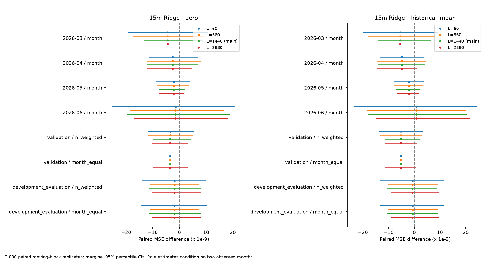
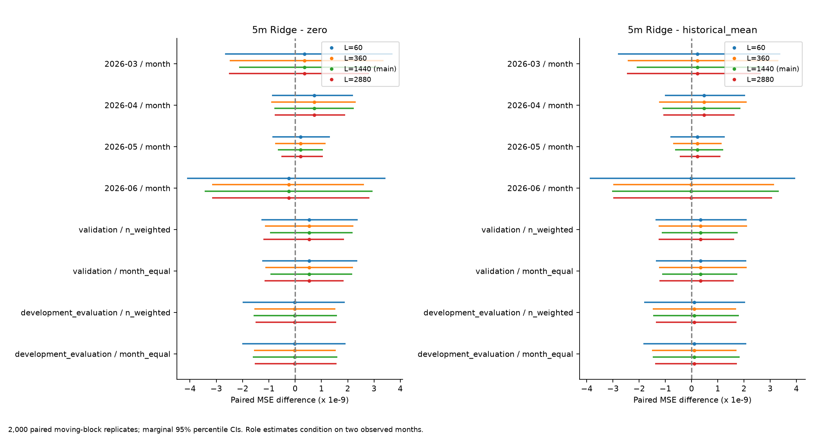
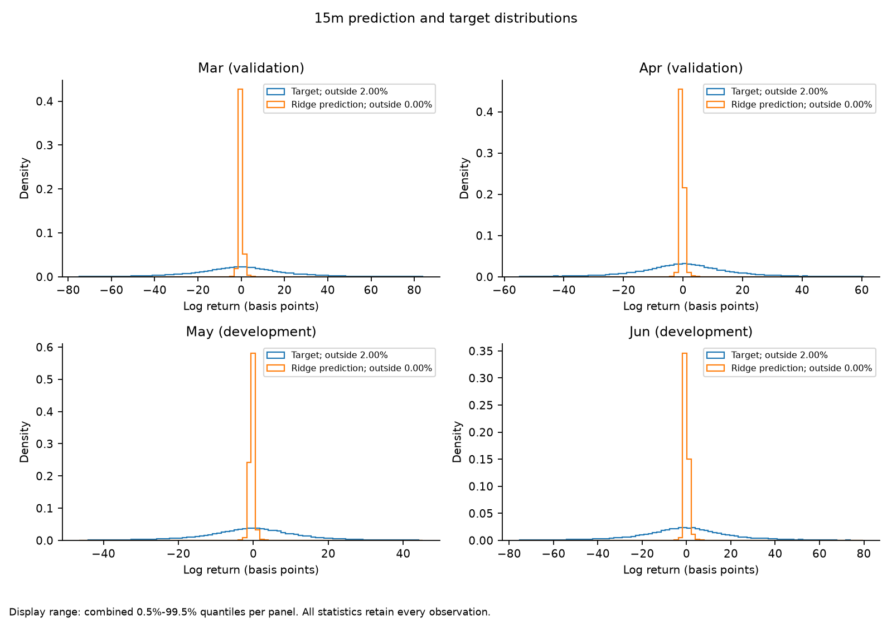
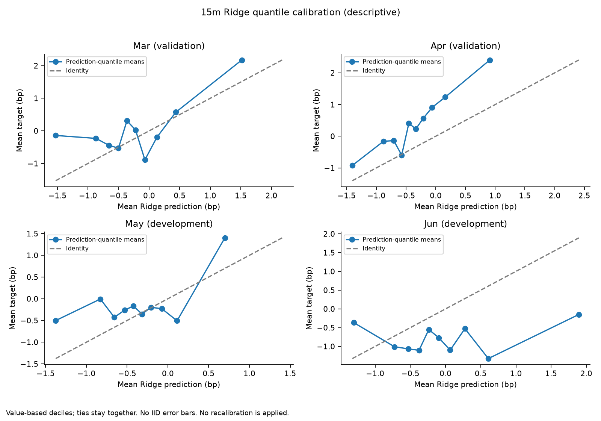
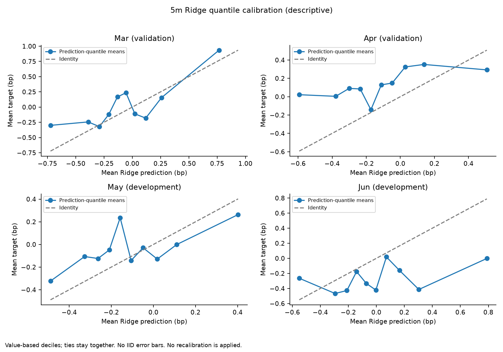
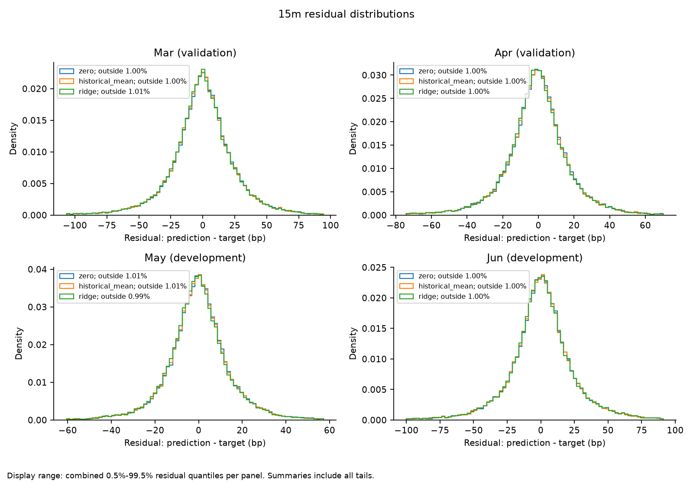
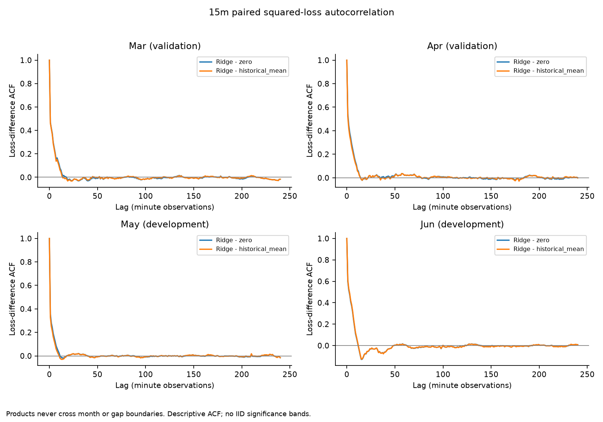

# Phase 2C：量化预测统计可靠性与校准诊断

核查日期：2026-11-03（Asia/Shanghai）。**未发现 Ridge 相对 Zero 或 Historical Mean 的可靠平方误差优势证据。128 组 Bootstrap 的绝对/相对95%区间均含0；96个 HAC 原始 p-value 均大于0.20，Holm校正均为1。**这不等于证明模型等效、没有alpha或没有交易价值。

## 研究边界与证据

Phase 2B 四个月表现已经观察过，本计划是后续诊断，不能当作首次观察前的预注册。从干净 `a431190` 重跑原始 Baseline，模型配置/状态、全部预测及非耗时指标一致，`git_dirty=false`；随后先写并哈希冻结计划，再实现统计代码。

正式 run `20261103T012342527623Z-d1bab75b`；同配置复跑 `20261103T012551082603Z-c847d61f`。7张统计表、配对审计、配置与14张PNG，共 **23个产物逐字节一致**。见 [复现证据](phase2c-reproducibility.json) 和 [完整summary](statistical-diagnostics-summary.json)。

固定预测源为 clean run `20261103T010111153259Z-a2cb0858`，SHA-256 `66f74e1367ed816455d8df2af5c8fdd89009c893aa5fe064df29fe646c86407a`。1,053,840 条模型记录一对一配对成351,280个 horizon 观测，未丢行；模型版本、真值、来源及成熟截止一致。三模型和两个horizon的重叠不能变成独立样本数。

计划SHA-256 `1dcb6c79d947a3c13e478efb367a1d77e8e3d671698fc0b6fb2c1864daac40d3`；基点 `a431190283c7c508751d4175a45ec84bff5e4bcf`。诊断在该提交上的新增dirty代码运行，逐源码/配置/锁文件哈希已记录。最终本地提交在验收后创建，不伪称旧提交单独包含诊断。

只有clean baseline复跑读取既有开发bar；之后诊断只读冻结预测与JSON元数据。没有新行情下载、最终留出行情访问、模型修改、调参、校准器回填或模拟/实盘订单。

## 固定统计契约

`d = loss_Ridge − loss_baseline`，负值有利于Ridge。正式推断使用平方损失；绝对损失只描述。相对MSE差是同权重平均差/对照MSE，bootstrap分母随同重采样，百分比不是交易收益。主任务15m、主对照Zero；5m和Mean为辅助；March/April Validation与May/June Development Evaluation始终分开。

Bootstrap固定seed42、B2000、非循环moving blocks L60/360/**1440**/2880、percentile95%区间。合法起点在连续片段内，最后块按原n截断，不跨月/角色/缺口；角色内按观测加权与月份等权分别组合。HAC采用Bartlett核、lags15/**60**/240、固定n自协方差分母、正态渐近z/p，无小样本修正。角色合并假设跨月协方差为0，不把月份拼接成一条平稳序列。

主lag60的32项构成一个Holm家族；另全部96项构成敏感性家族。校正p值不能修复后验方案选择或错误渐近假设；CI为边际95%而非同时区间。

## 主Bootstrap：角色内观测加权

| scope_id | horizon_minutes | baseline | estimate_mse_delta | ci_low | ci_high | relative_mse_delta_pct | relative_ci_low_pct | relative_ci_high_pct |
|---|---|---|---|---|---|---|---|---|
| validation | 15 | zero | -3.483131e-09 | -9.7162741e-09 | 4.2278176e-09 | -0.057345626 | -0.16815346 | 0.069067706 |
| development_evaluation | 15 | zero | -1.8090848e-09 | -1.1521335e-08 | 8.0999334e-09 | -0.035861116 | -0.22737525 | 0.15386706 |
| validation | 15 | historical_mean | -5.1832027e-09 | -1.1571983e-08 | 2.3547222e-09 | -0.085311412 | -0.18740051 | 0.038774986 |
| development_evaluation | 15 | historical_mean | -6.8960056e-10 | -1.0534785e-08 | 8.9546879e-09 | -0.013672845 | -0.2157896 | 0.16955404 |
| validation | 5 | zero | 5.3202632e-10 | -9.5387044e-10 | 2.1778084e-09 | 0.026080588 | -0.049745845 | 0.099797117 |
| development_evaluation | 5 | zero | -2.0013676e-11 | -1.5781237e-09 | 1.5863236e-09 | -0.001154215 | -0.092923339 | 0.086787544 |
| validation | 5 | historical_mean | 3.438954e-10 | -1.138829e-09 | 1.7617817e-09 | 0.016856623 | -0.056869471 | 0.084435199 |
| development_evaluation | 5 | historical_mean | 1.0358684e-10 | -1.4640465e-09 | 1.8091677e-09 | 0.0059744147 | -0.086257872 | 0.098368901 |

## 主Bootstrap：全部月份与两种汇总

| scope_id | aggregation | horizon_minutes | baseline | estimate_mse_delta | ci_low | ci_high | relative_ci_low_pct | relative_ci_high_pct |
|---|---|---|---|---|---|---|---|---|
| 2026-03 | month | 15 | zero | -4.4213069e-09 | -1.3247444e-08 | 8.949346e-09 | -0.17303739 | 0.10491224 |
| 2026-04 | month | 15 | zero | -2.5136718e-09 | -1.2015188e-08 | 6.9328696e-09 | -0.30572931 | 0.16689496 |
| 2026-05 | month | 15 | zero | -2.2107376e-09 | -7.8259567e-09 | 2.0704972e-09 | -0.28085005 | 0.082412668 |
| 2026-06 | month | 15 | zero | -1.3940388e-09 | -1.9488263e-08 | 1.8831386e-08 | -0.26223519 | 0.24305008 |
| validation | n_weighted | 15 | zero | -3.483131e-09 | -9.7162741e-09 | 4.2278176e-09 | -0.16815346 | 0.069067706 |
| validation | month_equal | 15 | zero | -3.4674894e-09 | -9.6883903e-09 | 4.2708256e-09 | -0.16881517 | 0.068899213 |
| development_evaluation | n_weighted | 15 | zero | -1.8090848e-09 | -1.1521335e-08 | 8.0999334e-09 | -0.22737525 | 0.15386706 |
| development_evaluation | month_equal | 15 | zero | -1.8023882e-09 | -1.1613164e-08 | 8.2131771e-09 | -0.22799854 | 0.15681524 |
| 2026-03 | month | 15 | historical_mean | -5.5489208e-09 | -1.4040069e-08 | 6.3967519e-09 | -0.17793393 | 0.08178289 |
| 2026-04 | month | 15 | historical_mean | -4.8052897e-09 | -1.3935981e-08 | 4.1793544e-09 | -0.34377083 | 0.09996263 |
| 2026-05 | month | 15 | historical_mean | -2.0608215e-09 | -7.2584839e-09 | 2.0730755e-09 | -0.25915852 | 0.080039029 |
| 2026-06 | month | 15 | historical_mean | 7.2734359e-10 | -1.7896503e-08 | 2.0559563e-08 | -0.24474519 | 0.26012932 |
| validation | n_weighted | 15 | historical_mean | -5.1832027e-09 | -1.1571983e-08 | 2.3547222e-09 | -0.18740051 | 0.038774986 |
| validation | month_equal | 15 | historical_mean | -5.1771052e-09 | -1.1502509e-08 | 2.3077898e-09 | -0.18786968 | 0.038336808 |
| development_evaluation | n_weighted | 15 | historical_mean | -6.8960056e-10 | -1.0534785e-08 | 8.9546879e-09 | -0.2157896 | 0.16955404 |
| development_evaluation | month_equal | 15 | historical_mean | -6.6673894e-10 | -1.067482e-08 | 9.1404385e-09 | -0.21581792 | 0.17091502 |
| 2026-03 | month | 5 | zero | 3.4754702e-10 | -2.1384527e-09 | 3.212447e-09 | -0.085982639 | 0.11006414 |
| 2026-04 | month | 5 | zero | 7.2265565e-10 | -7.8940685e-10 | 2.235674e-09 | -0.058826371 | 0.15342952 |
| 2026-05 | month | 5 | zero | 1.9946206e-10 | -6.6386276e-10 | 1.0469822e-09 | -0.074594242 | 0.11218756 |
| 2026-06 | month | 5 | zero | -2.4680612e-10 | -3.4348437e-09 | 2.9397254e-09 | -0.13317081 | 0.10973835 |
| validation | n_weighted | 5 | zero | 5.3202632e-10 | -9.5387044e-10 | 2.1778084e-09 | -0.049745845 | 0.099797117 |
| validation | month_equal | 5 | zero | 5.3510134e-10 | -9.3602432e-10 | 2.171289e-09 | -0.049921996 | 0.099557337 |
| development_evaluation | n_weighted | 5 | zero | -2.0013676e-11 | -1.5781237e-09 | 1.5863236e-09 | -0.092923339 | 0.086787544 |
| development_evaluation | month_equal | 5 | zero | -2.3672028e-11 | -1.6070617e-09 | 1.6078554e-09 | -0.09403328 | 0.087317495 |
| 2026-03 | month | 5 | historical_mean | 2.2328092e-10 | -2.099406e-09 | 2.7477141e-09 | -0.085272956 | 0.09740304 |
| 2026-04 | month | 5 | historical_mean | 4.6853084e-10 | -1.10431e-09 | 1.8575735e-09 | -0.083246991 | 0.1332224 |
| 2026-05 | month | 5 | historical_mean | 2.1500665e-10 | -6.3571724e-10 | 1.2000582e-09 | -0.068009724 | 0.12612756 |
| 2026-06 | month | 5 | historical_mean | -1.1547405e-11 | -3.0370757e-09 | 3.3222117e-09 | -0.12421856 | 0.11908753 |
| validation | n_weighted | 5 | historical_mean | 3.438954e-10 | -1.138829e-09 | 1.7617817e-09 | -0.056869471 | 0.084435199 |
| validation | month_equal | 5 | historical_mean | 3.4590588e-10 | -1.1274661e-09 | 1.7459402e-09 | -0.056599976 | 0.084346053 |
| development_evaluation | n_weighted | 5 | historical_mean | 1.0358684e-10 | -1.4640465e-09 | 1.8091677e-09 | -0.086257872 | 0.098368901 |
| development_evaluation | month_equal | 5 | historical_mean | 1.0172962e-10 | -1.488963e-09 | 1.831426e-09 | -0.087156336 | 0.098940496 |

四种块长的128行绝对/相对区间都含0，完整见 [bootstrap-results.csv](statistical-evidence/bootstrap-results.csv)。不能选更窄区间的块长来作结论。真实每月只有一个连续片段；L2880的n/L约14.99–15.50（抽15或16块），都触发少量块提示；这不代表15个独立市场状态。非循环MBB有有限样本边缘偏差，B2000有分位Monte Carlo误差。没有零分母draw被删除。

## HAC主结果及完整敏感性

| scope_id | aggregation | horizon_minutes | baseline | estimate_mse_delta | se | ci_low | ci_high | z | p_value | holm_main32_p | holm_global96_p |
|---|---|---|---|---|---|---|---|---|---|---|---|
| 2026-03 | month | 15 | zero | -4.4213069e-09 | 7.7229483e-09 | -1.9558007e-08 | 1.0715394e-08 | -0.57248951 | 0.56699039 | 1 | 1 |
| 2026-04 | month | 15 | zero | -2.5136718e-09 | 4.6472152e-09 | -1.1622046e-08 | 6.5947026e-09 | -0.54089852 | 0.58857753 | 1 | 1 |
| 2026-05 | month | 15 | zero | -2.2107376e-09 | 3.3494198e-09 | -8.7754798e-09 | 4.3540046e-09 | -0.660036 | 0.50923073 | 1 | 1 |
| 2026-06 | month | 15 | zero | -1.3940388e-09 | 1.1847989e-08 | -2.4615671e-08 | 2.1827593e-08 | -0.11766037 | 0.90633677 | 1 | 1 |
| validation | n_weighted | 15 | zero | -3.483131e-09 | 4.5417581e-09 | -1.2384813e-08 | 5.4185513e-09 | -0.76691249 | 0.44313354 | 1 | 1 |
| validation | month_equal | 15 | zero | -3.4674894e-09 | 4.5066767e-09 | -1.2300413e-08 | 5.3654347e-09 | -0.7694116 | 0.441649 | 1 | 1 |
| development_evaluation | n_weighted | 15 | zero | -1.8090848e-09 | 6.0703821e-09 | -1.3706815e-08 | 1.0088645e-08 | -0.29801827 | 0.76568922 | 1 | 1 |
| development_evaluation | month_equal | 15 | zero | -1.8023882e-09 | 6.1561649e-09 | -1.386825e-08 | 1.0263473e-08 | -0.29277777 | 0.76969202 | 1 | 1 |
| 2026-03 | month | 15 | historical_mean | -5.5489208e-09 | 7.469551e-09 | -2.0188972e-08 | 9.0911301e-09 | -0.74287207 | 0.45755914 | 1 | 1 |
| 2026-04 | month | 15 | historical_mean | -4.8052897e-09 | 4.3339316e-09 | -1.329964e-08 | 3.6890601e-09 | -1.1087599 | 0.26753375 | 1 | 1 |
| 2026-05 | month | 15 | historical_mean | -2.0608215e-09 | 3.0183374e-09 | -7.976654e-09 | 3.8550111e-09 | -0.68276711 | 0.49475402 | 1 | 1 |
| 2026-06 | month | 15 | historical_mean | 7.2734359e-10 | 1.2453312e-08 | -2.36807e-08 | 2.5135387e-08 | 0.058405632 | 0.95342553 | 1 | 1 |
| validation | n_weighted | 15 | historical_mean | -5.1832027e-09 | 4.3534787e-09 | -1.3715864e-08 | 3.3494588e-09 | -1.1905887 | 0.23381508 | 1 | 1 |
| validation | month_equal | 15 | historical_mean | -5.1771052e-09 | 4.3179033e-09 | -1.364004e-08 | 3.2858296e-09 | -1.1989859 | 0.23053342 | 1 | 1 |
| development_evaluation | n_weighted | 15 | historical_mean | -6.8960056e-10 | 6.3137117e-09 | -1.3064248e-08 | 1.1685047e-08 | -0.10922269 | 0.91302587 | 1 | 1 |
| development_evaluation | month_equal | 15 | historical_mean | -6.6673894e-10 | 6.4069367e-09 | -1.3224104e-08 | 1.1890626e-08 | -0.10406517 | 0.91711763 | 1 | 1 |
| 2026-03 | month | 5 | zero | 3.4754702e-10 | 1.6499638e-09 | -2.8863226e-09 | 3.5814166e-09 | 0.21063918 | 0.83316883 | 1 | 1 |
| 2026-04 | month | 5 | zero | 7.2265565e-10 | 7.9274585e-10 | -8.3109767e-10 | 2.276409e-09 | 0.91158553 | 0.36198694 | 1 | 1 |
| 2026-05 | month | 5 | zero | 1.9946206e-10 | 5.4917817e-10 | -8.7690737e-10 | 1.2758315e-09 | 0.36320101 | 0.71645474 | 1 | 1 |
| 2026-06 | month | 5 | zero | -2.4680612e-10 | 1.8393062e-09 | -3.85178e-09 | 3.3581678e-09 | -0.13418436 | 0.89325679 | 1 | 1 |
| validation | n_weighted | 5 | zero | 5.3202632e-10 | 9.2471463e-10 | -1.280381e-09 | 2.3444337e-09 | 0.57534109 | 0.56506064 | 1 | 1 |
| validation | month_equal | 5 | zero | 5.3510134e-10 | 9.1526314e-10 | -1.2587815e-09 | 2.3289841e-09 | 0.58464207 | 0.55878841 | 1 | 1 |
| development_evaluation | n_weighted | 5 | zero | -2.0013676e-11 | 9.466509e-10 | -1.8754153e-09 | 1.835388e-09 | -0.021141559 | 0.98313273 | 1 | 1 |
| development_evaluation | month_equal | 5 | zero | -2.3672028e-11 | 9.5977132e-10 | -1.9047892e-09 | 1.8574452e-09 | -0.024664238 | 0.98032278 | 1 | 1 |
| 2026-03 | month | 5 | historical_mean | 2.2328092e-10 | 1.5800315e-09 | -2.8735238e-09 | 3.3200857e-09 | 0.14131422 | 0.88762171 | 1 | 1 |
| 2026-04 | month | 5 | historical_mean | 4.6853084e-10 | 7.8072489e-10 | -1.0616618e-09 | 1.9987235e-09 | 0.60012284 | 0.54842437 | 1 | 1 |
| 2026-05 | month | 5 | historical_mean | 2.1500665e-10 | 5.3393117e-10 | -8.3147921e-10 | 1.2614925e-09 | 0.40268608 | 0.68717917 | 1 | 1 |
| 2026-06 | month | 5 | historical_mean | -1.1547405e-11 | 1.9032154e-09 | -3.7417811e-09 | 3.7186863e-09 | -0.0060673137 | 0.99515901 | 1 | 1 |
| validation | n_weighted | 5 | historical_mean | 3.438954e-10 | 8.9004782e-10 | -1.4005663e-09 | 2.0883571e-09 | 0.38637857 | 0.69921632 | 1 | 1 |
| validation | month_equal | 5 | historical_mean | 3.4590588e-10 | 8.8119673e-10 | -1.381208e-09 | 2.0730197e-09 | 0.39254104 | 0.6946585 | 1 | 1 |
| development_evaluation | n_weighted | 5 | historical_mean | 1.0358684e-10 | 9.7454279e-10 | -1.8064819e-09 | 2.0136556e-09 | 0.10629275 | 0.91535008 | 1 | 1 |
| development_evaluation | month_equal | 5 | historical_mean | 1.0172962e-10 | 9.8834602e-10 | -1.835393e-09 | 2.0388522e-09 | 0.10292916 | 0.9180192 | 1 | 1 |

| lag | min_raw_p | max_raw_p | tests |
|---|---|---|---|
| 15 | 0.20119299 | 0.99548122 | 32 |
| 60 | 0.23053342 | 0.99515901 | 32 |
| 240 | 0.22107425 | 0.99417315 | 32 |

最小原始p为0.20119299199，来自Validation、月份等权、15m、Ridge−Mean、lag15；主32项和全96项的Holm结果均为1，96个HAC区间全部含0。所有结果均可估计，未删短段/退化检验。完整 [hac-results.csv](statistical-evidence/hac-results.csv)。

HAC需弱依赖、适当有限矩及渐近近似；重叠标签、重尾与非平稳可能破坏假设。角色内仅两个月，共享扩张训练窗和市场延续性可能产生未建模的跨月协方差。没有通过“聚合后样本很多”声称多年/跨状态泛化。

## 月度IC、偏差与尺度

| month | horizon_minutes | pearson_ic | spearman_correlation | prediction_mean_bp | target_mean_bp | prediction_std_bp | target_std_bp | std_ratio_pct | prediction_bias_bp | diagnostic_slope |
|---|---|---|---|---|---|---|---|---|---|---|
| 2026-03 | 5 | 0.011872437 | 0.036017189 | -0.063119447 | 0.021331464 | 0.4520161 | 16.420358 | 2.7527786 | -0.084450912 | 0.43128921 |
| 2026-03 | 15 | 0.025921761 | 0.039226746 | -0.21323901 | 0.066389752 | 0.89759402 | 28.400266 | 3.1605127 | -0.27962876 | 0.82017583 |
| 2026-04 | 5 | 0.010595091 | 0.023976876 | -0.11648141 | 0.13047472 | 0.33240049 | 11.668449 | 2.8487118 | -0.24695613 | 0.37192568 |
| 2026-04 | 15 | 0.041083097 | 0.058203262 | -0.35519878 | 0.39335908 | 0.6798181 | 20.035197 | 3.3931191 | -0.74855786 | 1.2107767 |
| 2026-05 | 5 | 0.013068516 | 0.020241437 | -0.10708219 | -0.040570098 | 0.30631904 | 9.5753787 | 3.1990279 | -0.066512087 | 0.40851522 |
| 2026-05 | 15 | 0.032699233 | 0.023185643 | -0.36036256 | -0.12497998 | 0.67976371 | 16.262046 | 4.1800628 | -0.23538258 | 0.78226655 |
| 2026-06 | 5 | 0.015212684 | 0.018210223 | 0.0057651395 | -0.26480412 | 0.42279918 | 16.054816 | 2.6334727 | 0.27056926 | 0.57766627 |
| 2026-06 | 15 | 0.019353727 | 0.018112247 | -0.042335646 | -0.79666534 | 0.98660242 | 27.419661 | 3.5981568 | 0.75432969 | 0.53787892 |

均值、std和bias上表以log-return basis points（×10,000）显示；std用ddof0。15m预测std仅目标的3.16%–4.18%，5m为2.63%–3.20%。这本身不能证明预测应放大：低可预测性下收缩可能合理。正IC也只表明共同变化方向，不约束预测幅度/均值。

`MSE = bias² + Var(pred) + Var(target) − 2Cov(pred,target)`；相对Zero：`ΔMSE=E[pred²]−2E[pred×target]`。这些是逐月全样本验证的恒等式。

| month | horizon_minutes | bias_squared | prediction_variance | target_variance | covariance | prediction_second_moment | twice_prediction_target_moment | mse_delta_zero_from_moments |
|---|---|---|---|---|---|---|---|---|
| 2026-03 | 5 | 7.1319565e-11 | 2.0431855e-09 | 2.6962816e-06 | 8.8120388e-10 | 2.0830262e-09 | 1.7354792e-09 | 3.4754702e-10 |
| 2026-03 | 15 | 7.8192245e-10 | 8.0567502e-09 | 8.0657514e-06 | 6.6079517e-09 | 8.5114589e-09 | 1.2932766e-08 | -4.4213069e-09 |
| 2026-04 | 5 | 6.0987332e-10 | 1.1049009e-09 | 1.3615271e-06 | 4.1094101e-10 | 1.2405801e-09 | 5.1792442e-10 | 7.2265565e-10 |
| 2026-04 | 15 | 5.6033887e-09 | 4.6215264e-09 | 4.0140912e-06 | 5.5956367e-09 | 5.8831882e-09 | 8.39686e-09 | -2.5136718e-09 |
| 2026-05 | 5 | 4.4238577e-11 | 9.3831354e-10 | 9.1687878e-07 | 3.8331536e-10 | 1.0529795e-09 | 8.5351742e-10 | 1.9946206e-10 |
| 2026-05 | 15 | 5.540496e-10 | 4.6207871e-09 | 2.6445412e-06 | 3.6146872e-09 | 5.9193988e-09 | 8.1301365e-09 | -2.2107376e-09 |
| 2026-06 | 5 | 7.3207726e-10 | 1.7875915e-09 | 2.577571e-06 | 1.0326313e-09 | 1.7879239e-09 | 2.03473e-09 | -2.4680612e-10 |
| 2026-06 | 15 | 5.6901328e-09 | 9.7338434e-09 | 7.5183783e-06 | 5.2356292e-09 | 9.7517665e-09 | 1.1145805e-08 | -1.3940388e-09 |

15m的IC约0.019–0.041，弱协方差贡献与预测方差/偏差部分抵消，所以误差改善很小。5m三月到五月的诊断斜率约0.37–0.43，协方差带来的收益不足以覆盖尺度/均值项，正IC仍伴随更高MSE；六月相对Zero略好。这里的误差分解描述当前数据，不是因果根因证明。

诊断OLS斜率（Cov/Var）和截距只描述评价集，没有用于重新预测/计分。15m斜率从0.538到1.211、5m从0.372到0.578，不应从已见月份选择校准系数后宣布改进。

## 残差、平方损失分布与相关性

残差定义pred−target。以下Ridge分位数来自全样本，不裁剪；平方损失为自然log-return²单位。

| month | horizon_minutes | quantity | 0.01 | 0.5 | 0.99 | 1.0 |
|---|---|---|---|---|---|---|
| 2026-03 | 5 | residual | -0.0046719535 | -2.6610322e-06 | 0.0045471964 | 0.018765618 |
| 2026-03 | 5 | squared_error | 1.3863736e-10 | 5.3245641e-07 | 3.3603138e-05 | 0.0014297713 |
| 2026-03 | 15 | residual | -0.0084214969 | -7.4537062e-06 | 0.0074710508 | 0.022562463 |
| 2026-03 | 15 | squared_error | 5.1249951e-10 | 1.718573e-06 | 0.00010221963 | 0.001587692 |
| 2026-04 | 5 | residual | -0.0033186717 | -2.061972e-05 | 0.0032493475 | 0.014325579 |
| 2026-04 | 5 | squared_error | 6.8074505e-11 | 2.8148941e-07 | 1.7166976e-05 | 0.00020522221 |
| 2026-04 | 15 | residual | -0.0060706893 | -6.7344886e-05 | 0.0054746701 | 0.019799771 |
| 2026-04 | 15 | squared_error | 2.6408089e-10 | 8.7547629e-07 | 5.2619472e-05 | 0.00039203092 |
| 2026-05 | 5 | residual | -0.00267172 | -1.2891626e-05 | 0.0026808641 | 0.012757528 |
| 2026-05 | 5 | squared_error | 5.3623595e-11 | 1.9397355e-07 | 1.1586866e-05 | 0.00016275451 |
| 2026-05 | 15 | residual | -0.0045274411 | -3.9382689e-05 | 0.0046033162 | 0.015935006 |
| 2026-05 | 15 | squared_error | 1.9026224e-10 | 5.8519572e-07 | 3.4453004e-05 | 0.0002539244 |
| 2026-06 | 5 | residual | -0.0045861586 | 1.6709509e-05 | 0.0044157523 | 0.015276592 |
| 2026-06 | 5 | squared_error | 1.537466e-10 | 4.8462379e-07 | 3.2441873e-05 | 0.00074751887 |
| 2026-06 | 15 | residual | -0.0078797301 | 5.6400925e-05 | 0.0075940612 | 0.034474069 |
| 2026-06 | 15 | squared_error | 4.3041935e-10 | 1.511362e-06 | 9.0382357e-05 | 0.0011884614 |

全部模型/全部固定分位见 [distribution-quantiles.csv](statistical-evidence/distribution-quantiles.csv)；分位校准桶边界、实际n和均值见 [calibration-quantiles.csv](statistical-evidence/calibration-quantiles.csv)，ties不拆分。直方图仅为可读性显示合并0.5%–99.5%范围，各图标注范围外比例；统计仍含全部尾部。

损失差在短lag有明显相关，不能把分钟当IID；ACF逐月计算、缺口不连乘，不给未经修正的IID显著性带。完整 [loss-autocorrelation.csv](statistical-evidence/loss-autocorrelation.csv)。

## 全部真实图表

| 图类型 | 15m | 5m |
|---|---|---|
| 预测与目标分布 | [PNG](figures/phase2c/prediction-target-15m.png) | [PNG](figures/phase2c/prediction-target-5m.png) |
| 预测分位校准 | [PNG](figures/phase2c/quantile-calibration-15m.png) | [PNG](figures/phase2c/quantile-calibration-5m.png) |
| 残差分布 | [PNG](figures/phase2c/residual-distribution-15m.png) | [PNG](figures/phase2c/residual-distribution-5m.png) |
| 月度IC | [PNG](figures/phase2c/monthly-ic-15m.png) | [PNG](figures/phase2c/monthly-ic-5m.png) |
| 月度MSE差 | [PNG](figures/phase2c/monthly-mse-difference-15m.png) | [PNG](figures/phase2c/monthly-mse-difference-5m.png) |
| Bootstrap区间 | [PNG](figures/phase2c/bootstrap-ci-15m.png) | [PNG](figures/phase2c/bootstrap-ci-5m.png) |
| 损失差自相关 | [PNG](figures/phase2c/loss-acf-15m.png) | [PNG](figures/phase2c/loss-acf-5m.png) |

14张正式PNG全部来自冻结真实预测，已通过完整缩略总览及主区间图检查。合成测试图占位仅留在pytest临时目录，不作为正式图。

## 证据强度与下一步

本次没有样本内训练性能评价。月度验证/Development Evaluation是已见开发结果；统计显著性没有建立，跨市场状态泛化也未验证。交易收益还需要合法数据、执行价格、持仓账本、成本/风险约束，不能由IC/MSE直接推出。本次也没有证明“效果恰好为零”或“adaptive必定无效”。

当前证据足以支持继续做小预算、可证伪的算法比较，不能支持“自适应一定改善alpha”。优先A：固定扩张Ridge对预先指定固定滚动Ridge，保持14特征/成熟标签/alpha和训练预算；先隔离窗口选择的作用，再考虑漂移触发与延迟反馈在线更新。详见 [adaptive-alpha-proposal.md](../research/adaptive-alpha-proposal.md)。May/June后续结果必须标探索；July/August仍封存。

首轮耗时19.528秒（配对8.959、Bootstrap2.300、HAC1.316、校准/ACF0.612、绘图6.053）；测试与依赖、命令和故障记录见 [phase2c-record.md](phase2c-record.md)。
